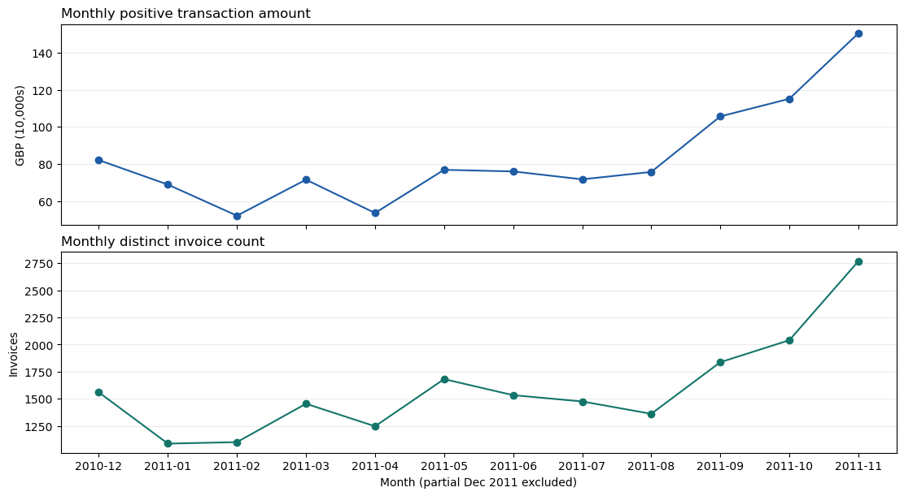

# 电商交易分析学习记录

**状态：进行中，已做到月度交易分析。** 这是一个用 Python、pandas 和 Matplotlib 练习交易数据分析的项目。每个阶段记录统计口径、核对结果和下一步，便于回顾分析是怎么推进的。

[分析 Notebook](ecommerce_analysis.ipynb) · [学习进度](LEARNING_LOG.md)

## 项目进度

| 阶段 | 进度 |
| --- | --- |
| 数据质量检查 | 已完成：区分商品明细、发票与客户，检查缺失、重复、非正数量及非正单价 |
| 清洗与金额核对 | 已完成：逐步筛选，并核对完全相同行去重前后的行数和金额 |
| 月度交易分析 | 已完成：汇总金额、不同发票数和平均每单金额，绘制月度趋势 |
| 国家与商品分析 | 待做：用同一口径比较不同市场及商品 |
| 客户分析与 SQL 核对 | 待做：定义客户分析的纳入范围，用 SQLite 复算关键指标 |
| 项目报告 | 待做：汇总发现、局限和后续问题 |

## 已经发现什么

- 原始数据有 **541,909 条商品明细、25,900 个不同发票号**。同一发票可有多条明细，原始发票数也含取消记录。
- 排除取消标记并保留正数量、正单价，再对全字段相同的行保留首次，得到 **524,878 条明细**。当前口径的正向交易金额为 **£10,642,110.80**。去重是本项目的探索性规则，金额未与取消或退货冲抵。
- 2011 年 10 月至 11 月，交易金额增长 **30.6%**，不同发票数从 **2,040** 增至 **2,769**，平均每单金额从 **£564.34** 降至 **£543.11**。这段金额增长来自订单数增加。
- 2011 年 12 月只覆盖到 **9 日 12:50**。月表保留该月，趋势图绘制至 2011 年 11 月。



## 本地运行

1. 在仓库根目录新建 `data/`，把从 [Kaggle E-Commerce Data](https://www.kaggle.com/datasets/carrie1/ecommerce-data) 下载的 CSV 解压为 `data/data.csv`。本项目使用该 CSV 版本，按 `cp1252` 读取。
2. 使用 Python 3.13，在仓库根目录安装依赖并启动 JupyterLab。

   ```bash
   python -m pip install -r requirements.txt
   python -m jupyterlab
   ```

3. 打开 `ecommerce_analysis.ipynb`，重启内核后从头运行。Notebook 保存了汇总输出，可在 GitHub 预览。

仓库版保留汇总结果与图表。原始 CSV、中间导出、运行缓存和个人学习档案由 Git 忽略。分析步骤中使用了 AI 的示例、排错与图表整理协助。

数据原出处为 Chen, D. (2015), *Online Retail*，UCI Machine Learning Repository。[UCI 数据页](https://archive.ics.uci.edu/dataset/352/online+retail) · [数据集 DOI](https://doi.org/10.24432/C5BW33)
